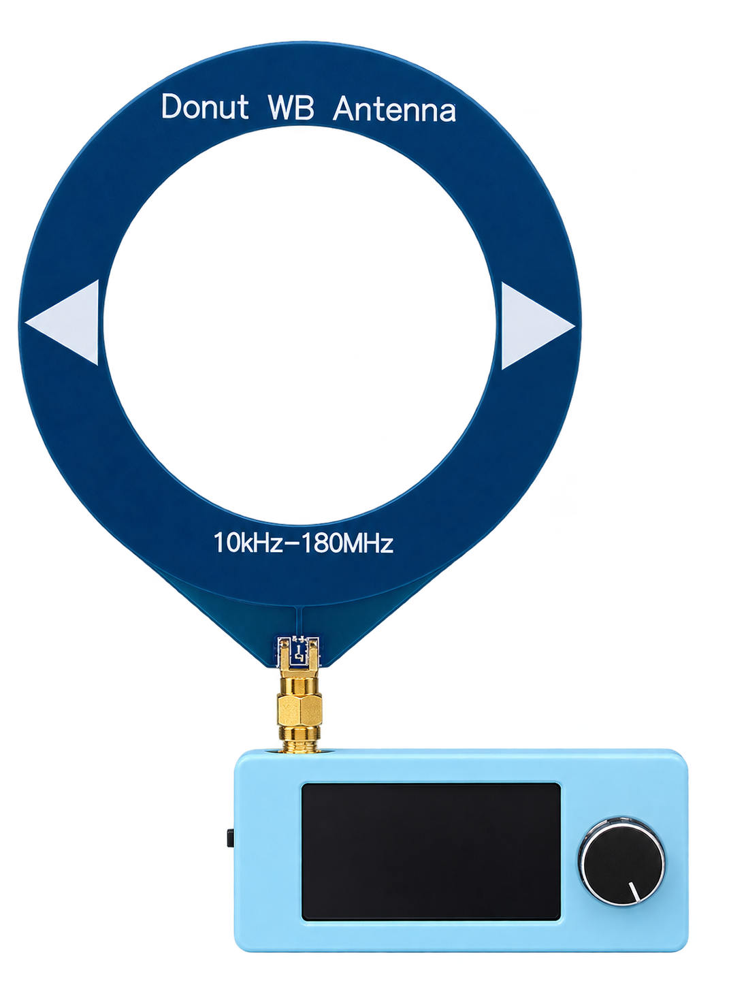
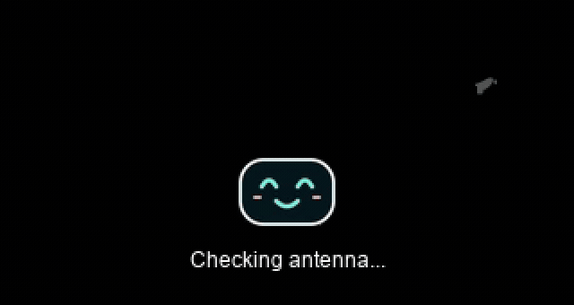
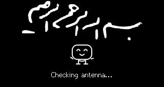

# SkyBlue · رادیوی ESP32-S3

<p align="center"></p>

<p align="center"><a href="README.md">English</a> · <a href="docs/BUILDING.md">راهنمای ساخت</a> · <a href="docs/FLASHING.md">نصب و بکاپ</a> · <a href="releases/refigh-v1.1.2/">نسخهٔ فعلی</a></p>

## پیش‌نمایش‌ها

| بوت بسم‌الله و صورت خندان | کلیپ بی‌صدای رفیق |
|---|---|
|  |  |
| [ویدیوی MP4](docs/assets/besmellah-preview.mp4) | [ویدیوی MP4](docs/assets/refigh-preview.mp4) |

این مخزن، نسخهٔ نصب‌شده و آزمایش‌شدهٔ Refigh را برای ادامهٔ توسعه نگه می‌دارد. سورس مبنای ATS Mini در کامیت اول و تغییرات Refigh در کامیت بعدی ثبت شده‌اند؛ مشخصات مرجع در [UPSTREAM.md](UPSTREAM.md) آمده است. تاریخچهٔ کامل Git پروژهٔ upstream وارد نشده است.

## نسخهٔ فعلی

نسخهٔ `refigh-v1.1.2` مکث ابتدای کلیپ را رفع می‌کند: متن و اولین فریم پشت صحنه آماده می‌شوند و هم‌زمان روی نمایشگر می‌آیند. چاپ تشخیصی USB در مسیر زمان‌بندی ویدیو وجود ندارد. فایل‌های نسخه و زمان‌های اندازه‌گیری‌شده در `releases/refigh-v1.1.2/` نگه داشته می‌شوند.

نسخهٔ `refigh-v1.1.1` شخصیت را به یک صورتِ خندان بزرگ‌تر، بدون دست و پا، با چشم‌ها و لبخند فیروزه‌ای تبدیل می‌کند. باینری و تصویر واقعی این نسخه در `releases/refigh-v1.1.1/` نگه داشته شده‌اند.

نسخهٔ `refigh-v1.1.0` صفحهٔ بررسی را با بسم‌اللهٔ سفید و انیمیشن نوشتن، آدمک خندان و متن Checking antenna… در پایین صفحه نمایش می‌دهد. تصویر زیر از خود نمایشگر رادیو گرفته شده است:



سورس SVG اصلی در `media/Besmellah.svg` و دارایی‌های آماده در `ats-mini/BootScreenAssets.h` هستند. برای بازسازی این بخش، علاوه بر requirements-media.txt به `rsvg-convert` از librsvg و ffmpeg نیاز است:

```sh
.venv/bin/python make_boot_assets.py
bash build.sh
```

نوشتن حروف از روی اسکلت فرم خوشنویسی تقریب زده می‌شود؛ صفحه به‌صورت ۴۴ فریم در حدود ۱٫۸ ثانیه روی همین برد آزمایش شده است. این انیمیشن پیش از نمونه‌برداری RF اجرا می‌شود. تخمین آنتن و تنظیمات رادیو در این نسخه تغییر نکرده‌اند. باینری، تصویر واقعی و لاگ‌ها در `releases/refigh-v1.1.0/` هستند.

## نسخهٔ پایهٔ Refigh

نسخهٔ `refigh-v1.0.0`، مورخ 2026-11-05:

- گزینهٔ ذخیره‌شوندهٔ `Settings → Refigh` با حالت‌های On و Off.
- تخمین آنتن با اسکن FM و الگوی کالیبره‌شده روی همین دستگاه، آنتن و محل.
- پخش ویدیوی بی‌صدا و متن فارسی با فونت Vazirmatn در حالت احتمال قطع آنتن؛ ردکردن کلیپ در حالت متصل یا نامشخص.
- آزمون مستقل هر دو حالت آنتن و ماندگاری Off پس از ریست؛ نتایج در [validation.json](releases/refigh-v1.0.0/validation.json).


تخمین، حسگر فیزیکی اتصال نیست؛ تغییر آنتن یا محل می‌تواند کالیبراسیون را نامعتبر کند. جزئیات در [یادداشت‌های فریم‌ور](docs/firmware-notes-fa.md) آمده‌اند.

## ساخت و آزمایش

ابزار مرجع Arduino CLI 1.5.1 و Espressif Arduino Core 3.3.11 است. وابستگی‌های C/C++ با نسخهٔ استفاده‌شده در `libraries/` نگه داشته شده‌اند. برای ساخت، نیازی به دانلود مجدد کتابخانه‌ها نیست:

```sh
bash build.sh
```

آزمون منطق تصمیم‌گیری، شامل ورودی‌های مبهم و تغییر یکنواخت قدرت سیگنال:

```sh
c++ -std=c++11 -Wall -Wextra -Werror test_decision.cpp -o test-decision
./test-decision
```

فایل‌های آمادهٔ نصب و هش‌هایشان در پوشهٔ هر نسخه در `releases/` هستند. جدول پارتیشن دستگاه تغییر نکرده است؛ فایل partitions-reference فقط مرجع است. فرمان‌های نصب و بازیابی در یادداشت‌های فریم‌ور ثبت شده‌اند. نسخهٔ 1.1.0 با همان بوت‌لودر 1.0.0 کار می‌کند و هنگام نصب فقط برنامهٔ آدرس 0x10000 نوشته شد.

دامپ کامل فلش دستگاه مالک وارد تاریخچهٔ Git نشده است. برای برد خودتان پیش از نصب یک بکاپ مستقل بگیرید؛ فرمان‌ها در [راهنمای نصب](docs/FLASHING.md) آمده‌اند.

## ویدیو و متن

ویدیوی اصلی در `media/refigh.mp4` و دارایی‌های آمادهٔ نمایش در `ats-mini/RefighAssets.h` نگه داشته شده‌اند. برای ساخت معمولی، همین هدر کافی است. برای تغییر کلیپ یا متن، `make_assets.py` را ویرایش و دارایی‌ها را دوباره بسازید:

```sh
python3 -m venv .venv
.venv/bin/pip install -r requirements-media.txt
.venv/bin/python make_assets.py media/refigh.mp4 --font-dir FONT_DIRECTORY
bash build.sh
```

ffmpeg و دو فونت Vazirmatn-Regular.ttf و Vazirmatn-Bold.ttf لازم‌اند. هش فونت‌های مرجع در `media/fonts-sha256.json` ثبت شده است؛ فایل‌های فونت در مخزن توزیع نشده‌اند.

## تغییرات بعدی

برای هر تغییر، از نسخهٔ فعلی یک شاخه بسازید؛ پس از ساخت و آزمایش، تغییرات همان شاخه را کامیت کنید:

```sh
git switch -c feature/next-change
git status
git diff
```

برای دیدن نسخهٔ فعلیِ حفظ‌شده بدون جابه‌جاکردن شاخهٔ کاری:

```sh
git show refigh-v1.0.0
git show refigh-v1.1.0
git show refigh-v1.1.1
git log --oneline --decorate
```

مخزن پروژه در [GitHub](https://github.com/foratik/SkyBlue-ESP32S3-Radio) قرار دارد. نسخه‌های برچسب‌خوردهٔ قبلی نیز برای مقایسه و بازگشت محفوظ‌اند. برای نگه‌داری یک نسخهٔ قابل‌انتقال از تاریخچه می‌توانید `git bundle create ../refigh-project.bundle --all` را اجرا کنید.
