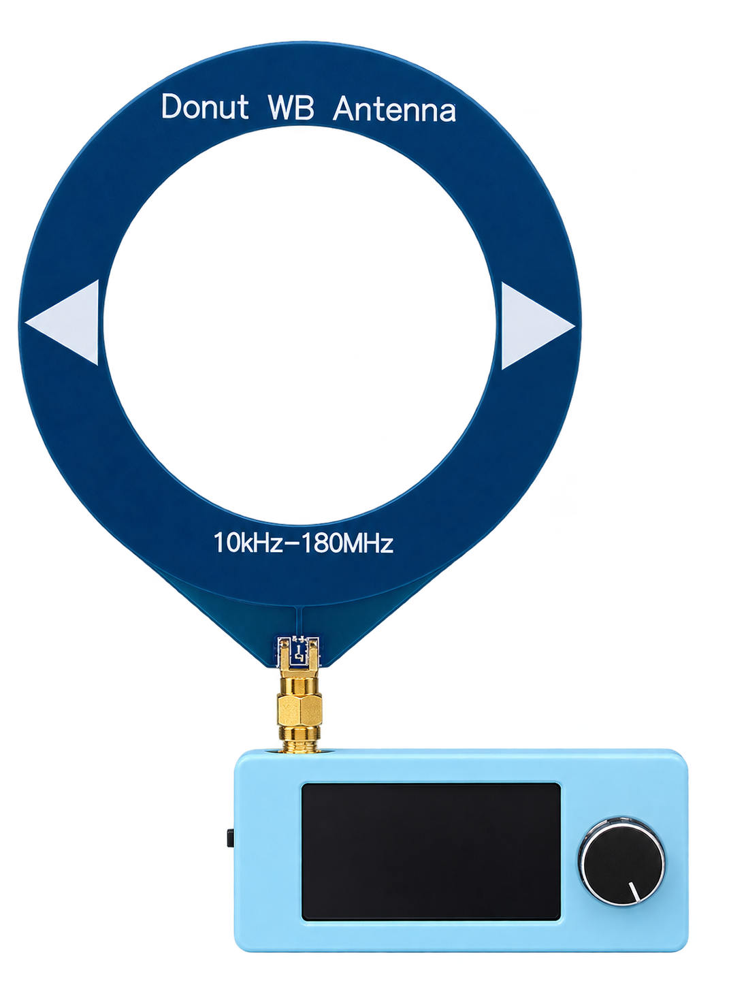
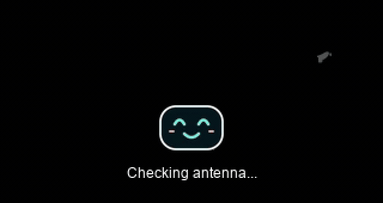

<div align="center">

<h1>SkyBlue · ESP32-S3 Radio</h1>
<p>A pocket radio with a little personality.</p>



<p>
  <a href="releases/refigh-v1.1.2/"></a>
  
  
  <a href="LICENSE"></a>
</p>

<p>
  <a href="#preview">Preview</a> ·
  <a href="#features">Features</a> ·
  <a href="#firmware">Firmware</a> ·
  <a href="#build">Build</a> ·
  <a href="README.fa.md">فارسی</a>
</p>

</div>

Custom firmware for an **ESP32-S3 / SI4732 pocket receiver**, based on [ATS Mini](https://github.com/esp32-si4732/ats-mini). SkyBlue adds a writing-style boot greeting, a mint smiling face, and the optional **Refigh** antenna-check experience.

## Preview

<table>
<tr><th width="50%">A little hello at startup</th><th width="50%">Refigh, when the antenna seems absent</th></tr>
<tr>
<td align="center"></td>
<td align="center"></td>
</tr>
<tr>
<td align="center">White calligraphy · animated smile · live check<br /><a href="docs/assets/besmellah-preview.mp4">Watch MP4</a></td>
<td align="center">7.5-second silent clip · Persian captions<br /><a href="docs/assets/refigh-preview.mp4">Watch MP4</a></td>
</tr>
</table>

The previews are generated from the firmware's actual display assets. [This screenshot](docs/assets/boot-screen.png) was captured from the radio itself.

## Features

- **A writing-style greeting.** The supplied Besmellah artwork appears in white along a reconstructed stroke path: 44 frames in about 1.8 seconds on the tested board.
- **A happy face.** A larger, face-only mascot with mint eyes, a gentle smile and blinking animation.
- **One persistent switch.** `Settings → Refigh → On / Off`; the choice is saved immediately.
- **An antenna-check experience.** With Refigh on, the radio samples FM reception. A likely-disconnected result plays the silent clip; a likely-connected or uncertain result goes straight to the radio.
- **Persian captions.** Vazirmatn text is pre-rendered beside the clip. The video and caption assets together occupy about **265 KiB**.
- **A paired first frame.** Captions and frame zero are prepared off-screen and presented together. Tested preparation: **50–51 ms**, followed by all 75 frames in 7.5 seconds.
- **The radio underneath.** FM, AM and SSB operation from ATS Mini, with the original settings and partition layout preserved on the tested device.

> Antenna estimation is experimental. It uses reception and an RF fingerprint calibrated for one antenna and location; it is not a physical connector sensor. Changing the antenna or environment can change its accuracy. Uncertain results skip the clip.

## Firmware

**Current snapshot: [`refigh-v1.1.2`](releases/refigh-v1.1.2/)** · [Change history](CHANGELOG.md) · [Hardware test results](releases/refigh-v1.1.2/validation.json)

| Snapshot | What changed |
|---|---|
| [v1.1.2](releases/refigh-v1.1.2/) | Paired video/caption startup; USB diagnostics removed from timed playback |
| [v1.1.1](releases/refigh-v1.1.1/) | Larger face-only mascot with mint features |
| [v1.1.0](releases/refigh-v1.1.0/) | Animated white calligraphy and a happy boot character |
| [v1.0.0](releases/refigh-v1.0.0/) | Refigh toggle, calibrated antenna estimation and silent video |

Each snapshot includes its application binary, checksums and validation records. The compatible bootloader and partition reference are in [v1.0.0](releases/refigh-v1.0.0/). See [flashing and backup instructions](docs/FLASHING.md) for the appropriate installation path.

## Tested hardware

| Part | Tested configuration |
|---|---|
| Controller | ESP32-S3, revision 0.2 |
| Memory | 16 MiB flash · 8 MiB PSRAM |
| Receiver | SI4732, ATS Mini-style hardware |
| Display | 320 × 170, 8-bit parallel interface |
| Controls | Rotary encoder with push button |
| Build profile | `lilygo_t_display_s3`, TFT_eSPI Setup206 |

The photo is the project's visual reference; the firmware pinout is defined in [`Common.h`](ats-mini/Common.h) and the vendored display setup. Other PCB revisions need their wiring checked against those definitions.

## Build

```sh
git clone git@github.com:foratik/SkyBlue-ESP32S3-Radio.git
cd SkyBlue-ESP32S3-Radio
bash build.sh
```

The reference toolchain is **Arduino CLI 1.5.1 + Espressif Arduino Core 3.3.11**. C/C++ libraries are vendored with their tested versions. [Full setup and asset-generation instructions →](docs/BUILDING.md)

Run the host-side antenna-decision checks:

```sh
c++ -std=c++11 -Wall -Wextra -Werror test_decision.cpp -o test-decision
./test-decision
```

## Project map

```text
ats-mini/            Radio firmware, boot screen and compressed display assets
libraries/           Pinned C/C++ dependencies and their licenses
media/               Original Refigh clip and Besmellah artwork
docs/assets/         Transparent product PNG, animated previews and screenshots
releases/            Versioned binaries, checksums and hardware validation
make_assets.py       Refigh video + Vazirmatn caption generator
make_boot_assets.py  Calligraphy reveal + smiling-face generator
```

## Credits

Built on [ESP32-SI4732 ATS Mini](https://github.com/esp32-si4732/ats-mini), with [PU2CLR SI4735](https://github.com/pu2clr/SI4735), [TFT_eSPI](https://github.com/Bodmer/TFT_eSPI), [TJpg_Decoder](https://github.com/Bodmer/TJpg_Decoder), and [Vazirmatn](https://github.com/rastikerdar/vazirmatn).

The source import is documented in [UPSTREAM.md](UPSTREAM.md). The firmware's original [MIT license](LICENSE) is preserved; bundled libraries retain their own licenses. [Artwork and image preparation notes →](docs/assets/IMAGE-NOTES.md)
